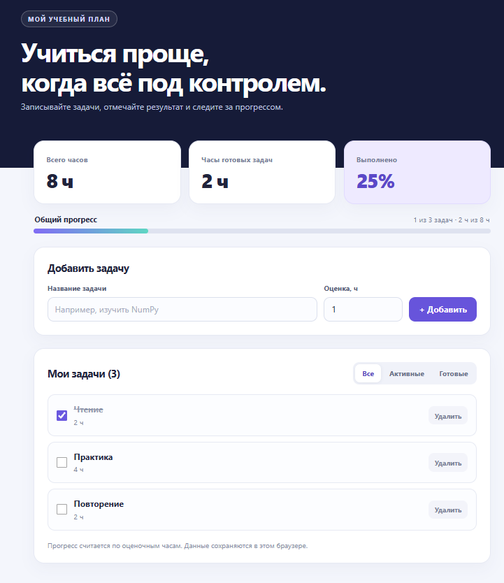
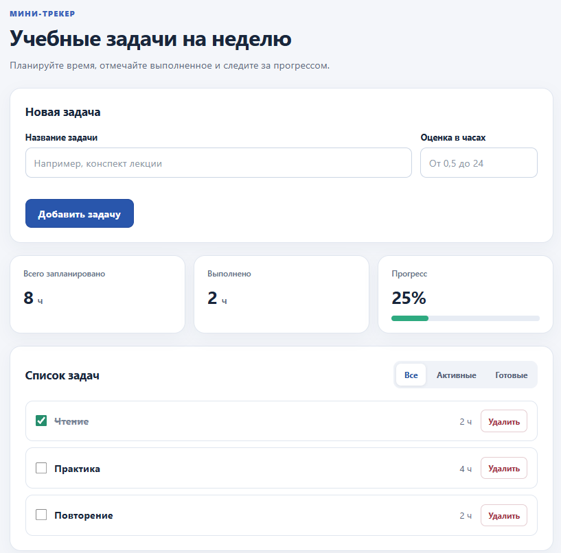

## Отчет. Задание A

Для задания использовалась модель GPT-6 High. Запросы в чатах указаны в файле [prompts.txt](prompts.txt).

Первая и вторая версия получились c немного своеобразными полями *оценка в часах* и *статус*. Они представлены не в виде колонок, а прописаны прямо в строке с задачей. 
Время: v1 - под задачей, v2 - справа. Статус готовых обознается как зачеркнутое название задания. Посчитал, что это не ошибка, не стал вносить изменения.

Ошибка возникла в версии v1:
  - В текстовом поле было возможно ввести пробелы, нажать кнопку добавить без возникновения ошибки (однако сама пустая задача в список не добавлялась)
  - Можно было выбрать больше 24 часов
Эти ошибки были исправлены, промты все еще описаны в [prompts.txt](prompts.txt).

Прилагаю скриншоты получившихся трекеров:

